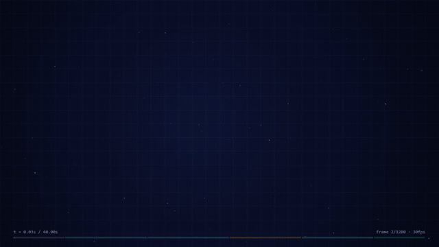

# Canvas Explainer Videos — an Agent Skill

[](https://github.com/junjie721/making-canvas-explainer-videos/actions/workflows/ci.yml)
[](LICENSE)

**In one sentence:** write one self-contained HTML + Canvas file and get a narrated explainer video as an MP4 — no image assets, no audio files, no video editor.



> The clip above is a 40-second export ([examples/tcp-handshake/tcp-handshake.mp4](examples/tcp-handshake/tcp-handshake.mp4), source in [examples/tcp-handshake/page.html](examples/tcp-handshake/page.html)). The bundled example is narrated in Chinese; the template's built-in example and the default voice follow the language of your narration text.

## What it does

- 15–90 second concept explainers: algorithms, math, AI agents, system flows, network protocols, anything
- The picture **and** the background music are generated from code — no assets, no licensing questions, reproducible renders
- Optional TTS narration: the timing adapts to the visuals, and a line that does not fit is reported instead of being silently sped up or cut off
- Frame-by-frame export → ffmpeg mixing (music ducks under the voice) → MP4; horizontal or vertical, any resolution
- The picture is a **pure function of the frame number** (`renderFrame(n)`), so the live preview and the export match exactly

## Quick start

### 1. Install the skill

```bash
git clone https://github.com/junjie721/making-canvas-explainer-videos.git
cd making-canvas-explainer-videos
node install.mjs                 # Codex: ~/.codex/skills
```

`install.mjs` can target other agents and projects too:

```bash
node install.mjs --target claude    # Claude Code: ~/.claude/skills
node install.mjs --target agents    # generic: ~/.agents/skills
node install.mjs --target all       # all three user-level directories
node install.mjs --target project   # ./.claude/skills and ./.codeartsdoer/skills (travels with the repo)
node install.mjs --dir .github/skills
```

Or copy the folder by hand — the skill is just the directory `making-canvas-explainer-videos/`, and its name must match the `name:` field in `SKILL.md`:

```bash
cp -r making-canvas-explainer-videos ~/.codex/skills/          # macOS / Linux
```

```powershell
Copy-Item ".\making-canvas-explainer-videos" "$env:USERPROFILE\.codex\skills\" -Recurse   # Windows
```

Or let Codex do it for you: *"install the skill from https://github.com/junjie721/making-canvas-explainer-videos/tree/main/making-canvas-explainer-videos"*.

The skill shows up in the agent's skill list on the next turn.

### 2. Install the dependencies (once)

```bash
node making-canvas-explainer-videos/scripts/doctor.js
```

That command tells you what is missing and how to install it. There are three things:

| Dependency | Required | Used for | Windows | macOS | Linux |
|---|---|---|---|---|---|
| Playwright | ✅ | rendering every frame | `npm i -g playwright` | same | same |
| ffmpeg / ffprobe | ✅ | mixing and encoding | `winget install Gyan.FFmpeg` | `brew install ffmpeg` | `sudo apt install ffmpeg` |
| edge-tts | recommended | neural narration voices | `python -m pip install edge-tts` | same | same |

No browser download is needed: the scripts fall back to the system Edge or Chrome (`PW_CHANNEL=chrome|msedge` forces one).

If ffmpeg refuses to install, `doctor.js` searches PATH, WinGet, Chocolatey, Scoop and the usual directories. As a last resort you can pull a bundled binary from npm:

```powershell
npm i -g @ffmpeg-installer/win32-x64 @ffprobe-installer/win32-x64
$bin = "$env:LOCALAPPDATA\Programs\ffmpeg\bin"; New-Item -ItemType Directory -Force $bin | Out-Null
$root = (npm root -g).Trim()
Copy-Item "$root\@ffmpeg-installer\win32-x64\ffmpeg.exe" $bin -Force
Copy-Item "$root\@ffprobe-installer\win32-x64\ffprobe.exe" $bin -Force
```

### 3. Ask for a video

In any agent that supports skills:

> Use making-canvas-explainer-videos to make a 40-second explainer about the TCP three-way handshake.

Or drive it yourself from the command line:

```bash
cp making-canvas-explainer-videos/template.html my-video/page.html
# edit only the CONTENT section of page.html: TITLE / INTRO / SEG / NARRATION / scene(t)

node making-canvas-explainer-videos/scripts/check.js my-video/page.html        # render everything + previews
node making-canvas-explainer-videos/scripts/make-video.js my-video/page.html   # write my-video/page.mp4
```

## Using it with other agents

The skill only depends on the shared skill format (`SKILL.md` with YAML frontmatter — only `name` and
`description` are required) plus plain Node scripts, so it is not tied to one product:

| Agent | Where skills live |
|---|---|
| Codex | `~/.codex/skills/` (Windows: `%USERPROFILE%\.codex\skills\`) |
| Claude Code | `~/.claude/skills/` (user) or `<project>/.claude/skills/` (project) |
| Anything that reads `AGENTS.md` | just open this repository — [AGENTS.md](AGENTS.md) carries the entry point and the invariants |
| Anything else | hand the agent `SKILL.md` and let it run the three commands; or run them yourself |

`agents/openai.yaml` is Codex-only UI metadata (display name, default prompt); other tools ignore it.

## Command line

**`check.js <page.html>`** — renders every frame, validates the timeline, estimates whether each narration line fits, and writes preview PNGs to `preview/`. A non-zero exit code means something is wrong (runtime error / narration too long / timeline gap / narration outside its segment) — fix it before exporting.

**`make-video.js <page.html>`** — exports the MP4.

| Flag | Meaning |
|---|---|
| `--voice <name>` | edge-tts voice; default follows the narration language (`zh-CN-XiaoxiaoNeural` / `en-US-AriaNeural`) |
| `--rate +5%` | speaking rate |
| `--out x.mp4` | output path |
| `--reuse` | reuse the previously exported frames and redo only the audio (invalidated automatically when the page changes) |
| `--format png` | lossless frames (crisper text, larger intermediate files) |
| `--quality 0.95` | JPEG quality |
| `--workers 4` | parallel browser pages for frame export |
| `--keep` | keep the intermediate frames and audio |

**`doctor.js [--browser]`** — dependency check; `--browser` really launches a browser to prove it works.

## How it works

1. `template.html` is a **single file**: background, helpers, music synthesis, playback and the export interface are already there. You edit the CONTENT section only.
2. The picture is a pure function `scene(t)` where `t` is the animation timeline in seconds; `SEG` defines the captions, `NARRATION` the voice-over.
3. `renderFrame(n)` maps a frame number to a picture, so frames can be exported with `canvas.toDataURL` across several parallel pages (~10× faster than element screenshots).
4. The background music is synthesized with maths in the Web Audio graph; the narration comes from edge-tts; ffmpeg aligns, mixes and encodes.
5. Narration start times are mapped onto real time with `SCALE`, and `check.js` verifies every line lands inside the segment it describes.

## FAQ

**`playwright not found` / `ffmpeg not found`** → run `doctor.js`; it prints the install command for your platform.

**The exported audio differs from the browser preview** → `edge-tts` is missing or offline, so the export fell back to the OS voice. Check whether the `[3/4]` line says `edge-tts` or `offline TTS`, then `python -m pip install edge-tts`.

**`Cannot connect to host speech.platform.bing.com`** → edge-tts needs internet and your environment blocks it. Re-run with network access; add `--reuse` to reuse the frames that were already exported.

**My ffmpeg is old** → the scripts adapt to older builds (no `amix normalize` option, explicit channel layouts) and say so in the log. Swap in a newer build in the same location whenever you like.

**A narration line is flagged as too long** → shorten it or lengthen that `SEG`, then re-run `check.js`.

**I want a 9:16 vertical video** → change the canvas `width`/`height` attributes and `W`/`H` in the code. The exported resolution follows the canvas; the scripts' viewport only affects the preview.

**The export got killed by a terminal timeout** → the frames are already on disk; re-run with `--reuse` to redo only the audio, or run it in the background with the log redirected to a file.

## Repository layout

```text
.
|-- making-canvas-explainer-videos/     # the skill itself — this is what goes into ~/.codex/skills/
|   |-- SKILL.md                        # entry point the agent loads
|   |-- template.html                   # the single-file template you edit
|   |-- agents/openai.yaml              # Codex UI metadata
|   `-- scripts/
|       |-- doctor.js                   # dependency check
|       |-- check.js                    # full-frame self-check + previews
|       |-- make-video.js               # export to MP4
|       `-- lib.js                      # browser/ffmpeg/python discovery + timeline validation
|-- examples/tcp-handshake/             # a complete worked example (40s export included)
|-- docs/demo.gif                       # the animation at the top of this README
|-- install.mjs                         # one-command install for several agents
|-- AGENTS.md                           # entry point for any agent that reads AGENTS.md
`-- tests/                              # browser- and network-free smoke tests (used by CI)
```

## Development

```bash
node tests/syntax-check.js     # every script parses
node tests/skill-manifest.js   # package structure (frontmatter, naming, docs vs scripts)
node tests/smoke-template.js   # all frames + timeline + narration windows + music determinism
node tests/install-script.js   # install.mjs install/skip/force/custom-dir behaviour
```

None of them needs a browser or the network; they finish in seconds. CI additionally renders the example
with a real Chromium.

## License

[MIT](LICENSE) © 2026 WANG JUN

---

## 中文说明

**用纯代码生成带解说的科普动画视频**：一个自包含的 HTML + Canvas 文件负责画面，Web Audio 合成背景音乐，TTS 生成解说，Playwright 逐帧导出，ffmpeg 混音封装成 MP4——不需要任何图片、音频素材。

```bash
git clone https://github.com/junjie721/making-canvas-explainer-videos.git
cd making-canvas-explainer-videos
node install.mjs                 # 装进 Codex（~/.codex/skills）；--target claude / all / project 可选
node making-canvas-explainer-videos/scripts/doctor.js   # 依赖自检：缺什么、怎么装一目了然
```

**依赖**：Playwright（必需）、ffmpeg + ffprobe（必需）、edge-tts（建议，装了才有神经网络中文语音；不装会退回系统语音）。浏览器不用单独装，脚本会自动回退到系统 Edge/Chrome。

**用法**：复制 `making-canvas-explainer-videos/template.html`，只改【本集内容】区块（`TITLE / INTRO / SEG / NARRATION / scene(t)`），然后

```bash
node .../scripts/check.js page.html        # 全帧自检 + 时间轴校验 + 预览图；退出码非 0 = 有问题
node .../scripts/make-video.js page.html   # 导出 page.mp4
```

常用参数：`--voice zh-CN-YunxiNeural`（男声）、`--rate +0%`（语速）、`--reuse`（复用已导出的帧，只重做音频）、`--format png`（无损帧）。默认音色会跟着解说的语种走：中文解说自动用 `zh-CN-XiaoxiaoNeural`，英文解说自动用 `en-US-AriaNeural`。

**常见问题**：装不上 ffmpeg 时 `doctor.js` 会搜 PATH / WinGet / Chocolatey / Scoop 和常见目录，还不行可以用 npm 上的二进制包兜底（README 上面有 PowerShell 命令）；解说太长会被 `check.js` 标红，缩短文案或拉长对应的 `SEG`；沙箱里 edge-tts 连不上网会明确报错，加 `--reuse` 可复用已导出的帧。

更多细节见英文部分（含原理、参数表、目录结构、测试与 CI 说明）。
