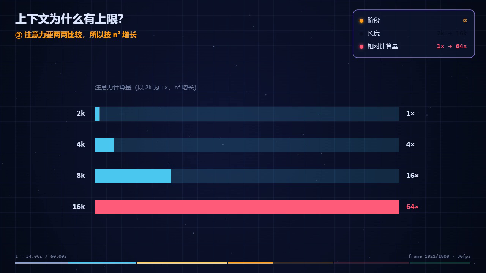

# Example: why a context window has a limit

A 60-second explainer (Chinese narration) that answers one question — *why does a longer context get
expensive, and why does it have to be capped?* — with a causal chain rather than a definition:

hook (length ×2 → work ×4) → tension (why isn't "just add VRAM" enough?) → mechanism (attention compares
every token with every other token, so work grows as n²) → boundary (a nominal limit is not the same as
what the model actually remembers) → payoff (put key instructions at the ends, retrieve before you feed).



| File | What it is |
|---|---|
| `page.html` | the source — `template.html` with the CONTENT section rewritten |
| `context-cost.mp4` | the 60s export (1280×720, Chinese narration) |
| `cost-check.mjs` | computes the relative attention work used in the video |
| `attention-cost.json` | the raw numbers the chart is drawn from |

## The data behind the chart

`node cost-check.mjs` (pure arithmetic — attention compares every pair, so work ∝ n²):

| context | relative attention work | pairwise comparisons |
|---|---|---|
| 2k | 1× | 4,194,304 |
| 4k | 4× | 16,777,216 |
| 8k | 16× | 67,108,864 |
| 16k | 64× | 268,435,456 |
| 32k | 256× | 1,073,741,824 |

Doubling the length quadruples the work — that is the whole reason context is capped, and why the bars in
the video jump instead of creeping up.

## Design notes

This example deliberately uses a different visual grammar from `examples/tcp-handshake` and
`examples/token-explained` (both are pipelines): it uses the **scale** grammar from
`references/visual-grammars.md`. It also follows the beat sheet in `SKILL.md` — the video spends most of
its time on *why*, not on *what*, and the last segment is an actionable rule rather than a slogan.

## Regenerate

```bash
node cost-check.mjs
node ../../making-canvas-explainer-videos/scripts/check.js page.html --sheet
node ../../making-canvas-explainer-videos/scripts/make-video.js page.html
```
