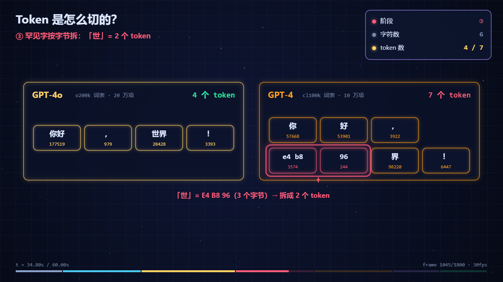

# Example: how a tokenizer splits "你好，世界！"

A 60-second explainer (Chinese narration) whose **numbers all come from a real tokenizer** instead of
being estimated by hand. It exists to demonstrate the rule in `SKILL.md`: any concrete number on screen
must come from a tool run, or be labelled as illustrative.



| File | What it is |
|---|---|
| `page.html` | the source — a copy of `template.html` with only the CONTENT section rewritten |
| `token-explained.mp4` | the 60s export (1280×720, Chinese narration) |
| `tokenize-check.py` | the script that produced the data below (`pip install tiktoken` first) |
| `tokenization.json` | the raw tokenizer output the video cites |

## The data behind the video

Produced with **tiktoken 0.14.0** on 2026-10-11:

| text | `o200k_base` (GPT-4o, 200,019 entries) | `cl100k_base` (GPT-4, 100,277 entries) |
|---|---|---|
| `你好，世界！` | 4 tokens — `你好`·177519, `，`·979, `世界`·28428, `！`·3393 | 7 tokens — `你`·57668, `好`·53901, `，`·3922, `e4 b8`·3574, `96`·244, `界`·98220, `！`·6447 |
| `你好` | 1 token | 2 tokens |
| `世界` | 1 token | 3 tokens (the `世` bytes are split) |
| `tokenization` | 2 tokens | 2 tokens |
| `ChatGPT` | 2 tokens (`Chat` \| `GPT`) | 3 tokens (`Chat` \| `G` \| `PT`) |

The interesting part: the same six characters cost **4 tokens in one model and 7 in another**, and the
rare character `世` (U+4E16 = bytes `E4 B8 96`) is emitted as two byte-level tokens by the older
vocabulary. That is the mechanism behind "why is Chinese more expensive per character".

## Regenerate

```bash
pip install tiktoken
python tokenize-check.py          # rewrites tokenization.json and prints a report

node ../../making-canvas-explainer-videos/scripts/check.js page.html
node ../../making-canvas-explainer-videos/scripts/make-video.js page.html --voice zh-CN-XiaoxiaoNeural
```

The narration is Chinese, so `make-video.js` picks a Chinese voice automatically; pass `--voice` to override.
